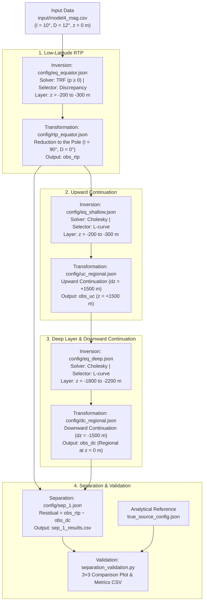
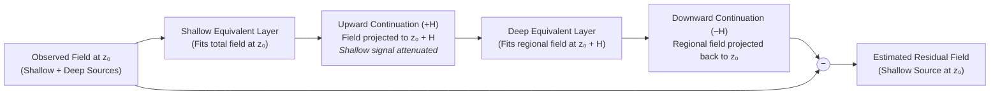

# Gmag Filtros

Projeto que reúne desenvolvimento de filtros para aplicação em dados potenciais pelos alunos do GMAG UFPA.

## Configurando ambiente de desenvolvimento

O ambiente de desenvolvimento é primariamente em Python, assim é necessário que todos os alunos façam o seguinte:

- Em um pc (Windows ou Linux), instale o Python disponível em [https://www.python.org/downloads/](https://www.python.org/downloads/)
- Escolham um editor/IDE, recomenda-se o VS Code e as seguintes extensões: Pylance, Python, Python Debugger, Python Environments, Rainbow CSV
- Usem a estrutura de diretório presento no arquivo gmag_filtros.zip
- Configure um ambiente virtual para o projeto
- Faça o download dos pacotes necessários informados no arquivo de ambiente requirements.txt

Para configurar um ambiente virtual siga os passos abaixo.

### Configurando Python Env no Windows

Comando para criar o ambiente virtual na pasta raiz do projeto

```shell
python -m venv .venv
```

Para instalar os pacotes necessários para o projeto, primeiro deve-se ativar o ambiente manualmente pelo terminal ou deixando o VS Code ativar. Use o comando abaixo no terminal para ativar o ambiente virtual.

```shell
.\.venv\Scripts\Activate.ps1
```

Você saberá que o ambiente está ativado quando o terminal no VS Code exibir a expressão "(.venv)" como mostrado abaixo

```shell
(.venv) usuario:~/Caminho/gmag_filtros$ 
```

Pode ser que o Windows impeça a ativação do ambiente devido a questões de segurança em relação a execuções de comandos em Shell, se durante a a ativação do ambiente o terminal exiba alguma mensagem de erro onde o ambiente não for ativado, use o comando abaixo para liberar a sessão

```shell
Set-ExecutionPolicy Unrestricted -Scope Process
```

Depois tente ativar o ambiente novamente, deve funcionar agora.

### Configurando Python Env no Linux

Comando para criar o ambiente virtual na pasta raiz do projeto

```shell
python3 -m venv .venv
```

Use o comando abaixo no terminal para ativar o ambiente virtual.

```shell
source .venv/bin/activate
```

### Instalando os pacotes necessários para o projeto

Os pacotes a serem usados nesse projeto são: harmonica, verde, numpy, pandas, matplotlib e seaborn. Pelo menos por enquanto são esses, caso seja necessário instalar outros, faremos depois. Para instalar esses pacotes, existem duas opções.

A opção 1, com o ambiente já ativado, requer o comando

```python
pip install pacote 
```

A opção 2 (a que vamos usar aqui) é instalar os pacotes diretamente de um arquivo de ambiente chamado requirements.txt. Isso é bom porque garante que todos usem exatamente a mesma versão de todos os pacotes. Digite o comando abaixo no terminal

```python
pip install -r requirements.txt
```

Pronto, o ambiente já está configurado, pode começar a trabalhar :)

## Descrição do diretório

Esse projeto contém as seguintes pastas:

- code
- synthetic data
- validation
- data
- output

### Pasta Code

A pasta code é onde fica localizado todos os códigos do trabalho, divididas em subpastas:

- equivalent_layer: onde ficam os códigos principais
  - run_ceq.py: é o script principal que executa todas as tarefas
  - inversion_stage.py: é o script responsável pela construção da camada equivalente
  - transformation_stage: é o script que executa a maioria das transformações
  - poisson_stage: script que contém as instruções para a execução da transformação Razão de Poisson (Poisson ratio)

- frequency: contém o código adaptado do fortran que realiza diversas transformações no domínio da frequencia

- modules: contém os módulos onde as funções que executam diversas tarefas estão
  - constants.py: módulo para guardar valores de constantes, não usado no momento
  - kernel.py: contém as funções do método grav e mag
  - utils.py: contém funções de leitura e escrita de dados e plots

### Pasta synthetic data

Essa pasta contém os scripts que produzem modelos sintéticos.

- synthetic_data_template.py: produz dados sintéticos (grav e mag) em grid regular e superficie de observação plana, N prismas.
- synthetic_data_scattered: produz dados sintéticos (grav e mag) em dados espalhados espacialmente.

### Pasta validation

Aqui está os testes que mostram a validação das funções que realizam as Transformações.

**Sugestão**: para desenvolver sua transformação, faça nesse formato onde um unico arquivo le os dados de entrada e produz a transformação. Assim que o resultado for validado, a sua função será depois incorporado ao código do projeto. Olhe o arquivo gmag_filtros/code/validation/transf_name_validation.py para usar como template.

### Pasta data

Nessa pasta estão os datasets a serem analizados. Cada subpasta aqui deve ser um único dataset. A execução do script run_ceq.py lê essa pasta e os arquivos contidos nela para produzir resultados, assim os resultados estão em gmag_filtros/data/dataset_name.

### Pasta config_templates

Aqui tem templates para criação de arquivos de configuração da camada equivalente e das transformações.

## Equivalent Layer Solvers

The inversion solver is configured via `"solver"` inside `inversion_parameters` in the equivalent layer JSON file.

| Solver | Constraint | Scaling / Speed | When to Use |
| :--- | :--- | :--- | :--- |
| **`cholesky`** *(default)* | Unconstrained ($p \in \mathbb{R}$) | Very fast ($G^T G$ precomputed once) | Gravity data, Poisson ratio, upward/downward continuation, and high-latitude magnetic data. |
| **`bvls`** | Positivity ($p \ge 0$) | Slow for $N > 1000$ (active-set dense solver) | Low-latitude magnetic RTP on small grids ($N \lesssim 1000$) under strictly induced magnetization. |
| **`trf`** | Positivity ($p \ge 0$) | Much faster than `bvls` on medium/large grids | Low-latitude magnetic RTP on larger grids ($N > 1000$) under strictly induced magnetization. |

> **Note on Positivity Constraints (`bvls` and `trf`):** Imposing $p \ge 0$ eliminates neighbor sign oscillations that cause striation artifacts in low-latitude Reduction to the Pole (RTP). It assumes strictly induced magnetization with positive susceptibility contrast and is **not** valid for gravity inversions or bodies with strong remanence.

## Como usar o run_ceq.py

Antes de qualquer coisa, garanta que o terminal esteja aberto (e com ambiente virtual ativado) na pasta onde está o run_ceq.py, ou seja, no terminal deve ter um caminho desse tipo: **seu_caminho/gmag_filtros/code/equivalent_layer**.

Cada dataset deve ser salvo dentro da pasta gmag_filtros/data/**dataset_name**. Nessa pasta deve conter um arquivo com os dados grav e outro com os dados mag. Cada arquivo de dados observados deve seguir a ordem: X,Y,Z,Obs, onde X é Easting, Y é Northing, Z é upwards e Obs é o dado observado. Lembrando que o sistema de coordenadas esperado para a execução da Camada Equivalente Clássica (script run_ceq.py) é o ENU, onde Eixo X é Easting, Y é Northing e Z é Upwards em metros, positivo para cima.

### Exemplo com dataset model2

Vamos usar como exemplo o dataset model2, dentro dessa pasta existe a pasta **input** onde estão os arquivos de dados observados mag e grav, bem como as imagens dos campos e da fonte verdadeira (isso é possível porque o arquivo synthetic_data_template.py ao gerar o dado sintético, já organiza desta forma). Outra pasta que já vai existir aqui caso o dataset tenha sido criado pelo script será a pasta **config**, com um arquivo chamado eq_layer1.json. Nessa pasta ficarão os arquivos de configuração para construção da camada equivalente e das transformações. Você deve preencher o arquivo eq_layer1.json com as informações relevantes para a construção da camada equivalente que você deseja. É possível construir várias camadas, desde que você use diferentes arquivos json para tal, basta copiar e mudar o nome do arquivo e preencher com as informações necessárias.

Representação do diretório de model2:

- data
  - model2
    - config
      - eq_layer1.json
    - input
      - model2_grav.csv
      - model2_mag.csv
      - figuras e metadata file com informações da fonte

Exemplo do arquivo eq_layer1.json para o dataset model2:

```json
{
    "project_settings": {
        "gravity_file": "model2_grav.csv",
        "magnetic_file": "model2_mag.csv"
    },
    "data_columns": {
        "easting_col": "X",
        "northing_col": "Y",
        "upwards_col": "Z",
        "field": "obs"
    },
    "inversion_parameters": {
        "z_top": -200.0,
        "z_bottom": -1000.0,
        "incf": 45.0,
        "decf": 12.0,
        "incs": 45.0,
        "decs": 12.0,
        "reg_min": 1e-06,
        "reg_max": 100.0,
        "steps": 20
    }
}
```

Para executar a construção da Camada Equivalente Clássica (um prisma embaixo de cada ponto de observação), vá na pasta gmag_filtros/code/equivalent_layer/ e encontre o arquivo run_ceq.py, esse é o arquivo que executa esta tarefa. Então, no terminal digite o seguinte comando:

```shell
python run_ceq.py --dataset DATASET_NAME --type DATA_TYPE --eq-config EQ_FILENAME --trans-config TRANSFORMATION_FILENAME --poisson-config POISSON_FILENAME
```

Onde:

- DATASET_NAME é o nome da sua pasta de dados
- DATA_TYPE é o tipo de dado que será processado (grav/gravity ou mag/magnetic)
- EQ_FILENAME é o arquivo de configuração para criar a camada equivalente
- TRANSFORMATION_FILENAME é o arquivo de configuração para uma transformação
- POISSON_FILENAME é o arquivo de configuração específico para a transformação Razão de Poisson

Dê Enter e espera a finalização do processo, uma mensagem aparecerá no terminal quando o processo estiver completo.

**Observação**: você não precisa rodar o comando com todas as flags ativadas de uma única vez, é possível fazer por partes. Por exemplo, caso queira construir só a camada equivalente, use

```shell
python run_ceq.py --dataset DATASET_NAME --type DATA_TYPE --eq-config EQ_FILENAME 
```

Assim, uma pasta com o mesmo nome de EQ_FILENAME será criada para guardar os resultados da camada equivalente do tipo DATA_TYPE que criada com as informações presentes em EQ_FILENAME.

Quando esta tarefa for executada, o diretório da dataset mudará para:

- data
  - model2
    - config
      - eq_layer1.json
    - eq_layer1
      - DATA_TYPE_standard_equivalent_sources_parameters.csv
      - DATA_TYPE_standard_l_curve_metrics
      - figura de comparacao entre campo obs e campo predito pela camada equivalente
    - input
      - model2_grav.csv
      - model2_mag.csv
      - figuras e metadata file com informações da fonte

A pasta **eq_layer1** foi criada para guardar os resultados da camada equivalente criada pelo arquivo de mesmo nome. Assim, toda vez que você criar uma nova camada com nome diferente, uma pasta nova será criada. Isso permite que voce execute transformações para cada camada equivalente de forma isolada. Nessa pasta temos os seguintes arquivos:

- DATA_TYPE_standard_equivalent_sources_parameters.csv: arquivo com as informações dos prismas da camada e o valor da propriedade física estimada
- DATA_TYPE_standard_l_curve_metrics: arquivo com informações da curva L, método usado para resolver o sistema de equações da inversão

Para executar uma transformação, primeiro é preciso criar o arquivo de configuração referente a tal transformação. Na pasta **config_templates** existe alguns exemplos de como fazer tal, abaixo está o arquivo para continuação para cima:

```json
{
    "eq_layer_config": "eq_layer1",
    "transformation_type": "upward_continuation",
    "data_type": "magnetic",
    "execute": true,
    "parameters": {
        "dz": 500
    }
    
}
```

Nesse arquivo tem-se a determinação de:

- eq_layer_config: é o arquivo que contém as informações da camada equivalente que será usada de input para a transformação
- transformation_type: nome da transformação
- data_type: tipo de dado
- execute: flag para confirmar execução da transformação
- parameters: aqui dentro ficam os parametros especificos da transformação, no caso da continuação para cima é a altura do plano de observação desejado

Com uma camada equivalente já construída, para executar a transformação basta digitar no terminal:

```shell
python run_ceq.py --dataset DATASET_NAME --type DATA_TYPE --trans-config TRANSFORMATION_FILENAME 
```

Quando esta tarefa for executada, o diretório da dataset mudará para:

- data
  - model2
    - config
      - eq_layer1.json
    - eq_layer1
      - DATA_TYPE_standard_equivalent_sources_parameters.csv
      - DATA_TYPE_standard_l_curve_metrics
      - figura de comparacao entre campo obs e campo predito pela camada equivalente
      - transformations
        - TRANSFORMATION_FILENAME
          - resultados da transformacao aqui
    - input
      - model2_grav.csv
      - model2_mag.csv
      - figuras e metadata file com informações da fonte

Essa nova organização permite que eu possa fazer diversas transformações para uma única camada.

## A fazer

- Implementar as transformações: Derivadas, HGM, Tilt, ASA e Deconvolução de Euler

## Tutorial: Low-Latitude RTP and Regional-Residual Separation (`model4`)

This walkthrough demonstrates how to chain equivalent-layer inversions and transformations in `gmag_filtros` to solve a complete magnetic processing workflow:

1. Invert noisy low-latitude magnetic data ($I = 10^\circ, D = 12^\circ$) using a **positivity-constrained solver (`trf`)** and **Morozov's discrepancy principle** to avoid striation artifacts.
2. Apply **Reduction to the Pole (RTP)** to project the field to $I = 90^\circ, D = 0^\circ$.
3. Chain a **shallow-to-deep equivalent layer separation** using upward and downward continuation ($H = 1500\text{ m}$) to isolate the regional (deep) and residual (shallow) anomalies.
4. Validate all three stages quantitatively against the analytical prism fields.

The flowchart below summarizes the test.



The flowchart below summarizes how to use continuation transformation as regional residual separation method



---

### 1. Synthetic Benchmark Setup

The `model4` dataset represents two superimposed magnetic prisms with strictly induced magnetization near the magnetic equator, observed on a flat surface ($z = 0\text{ m}$) over a $4000 \times 4000\text{ m}$ grid ($200\text{ m}$ spacing, $21 \times 21$, $N = 441$):

| Parameter | Shallow Source (Residual) | Deep Source (Regional) |
| :--- | :--- | :--- |
| **Horizontal Bounds ($X, Y$)** | $[1800, 2200]\text{ m} \times [1800, 2200]\text{ m}$ | $[1600, 2400]\text{ m} \times [1600, 2400]\text{ m}$ |
| **Depth Bounds ($z_{\text{bottom}}, z_{\text{top}}$)** | $-600\text{ m}$ to $-300\text{ m}$ | $-3200\text{ m}$ to $-2000\text{ m}$ |
| **Magnetization Intensity ($M$)** | $2.0\text{ A/m}$ | $2.5\text{ A/m}$ |
| **Ambient Field ($I, D$)** | $I = 10.0^\circ, D = 12.0^\circ$ | $I = 10.0^\circ, D = 12.0^\circ$ |

- **Noise:** $3\%$ Gaussian noise (seed `32`) added to the total anomaly ($\max\vert{}\text{obs}\vert{} = 90.69\text{ nT} \Rightarrow \sigma \approx 2.72\text{ nT}$).
- **Window padding:** Centering the bodies at $(2000, 2000)\text{ m}$ leaves a $1600\text{ m}$ buffer to all four grid edges, preventing dipole-lobe truncation at low inclination.

Place the input data and configuration files in the following layout:

```text
data/model4/
├── true_source_config.json
├── input/
│   └── model4_mag.csv
├── config/
│   ├── eq_equator.json
│   ├── eq_shallow.json
│   └── eq_deep.json
    ├── rtp_equator.json
    ├── uc_regional.json
    ├── dc_regional.json
    └── sep_1.json
```

### 2. Workflow Configuration Files

#### Step A — Low-Latitude Equivalent Layer & RTP

At $I = 10^\circ$, the magnetic Jacobian is severely ill-conditioned. Unconstrained Cholesky + L-curve inversions tend to fit noise using alternating positive/negative magnetizations between neighboring prisms, which turn into strong stripes when projected to the pole. Setting "solver": "trf" enforces $p \ge 0$ (valid for strictly induced magnetization with positive susceptibility contrast), and "reg_selector": "discrepancy" selects the smoothest regularization parameter $\mu$ whose data misfit stays within the noise floor ($\text{RMSE} \le \sigma$).

File: data/model4/config/eq_equator.json

```json
{
    "project_settings": {
        "magnetic_file": "input/model4_mag.csv"
    },
    "data_columns": {
        "easting_col": "X",
        "northing_col": "Y",
        "upwards_col": "Z",
        "field": "obs"
    },
    "inversion_parameters": {
        "z_top": -200.0,
        "z_bottom": -300.0,
        "incs": 10.0,
        "decs": 12.0,
        "solver": "trf",
        "reg_selector": "discrepancy",
        "noise_sigma": 2.72,
        "reg_min": 1e-3,
        "reg_max": 1e4,
        "steps": 15
    }
}
```

File: data/model4/rtp_equator.json

```json
{
    "execute": true,
    "eq_layer_config": "eq_equator",
    "transformation_type": "reduction_to_pole",
    "data_type": "magnetic",
    "parameters": {
        "inc_new": 90.0,
        "dec_new": 0.0
    }
}
```

#### Step B — Shallow Layer at the Pole & Upward Continuation

Once the data is at the pole (obs_rtp), the inverse problem is well-conditioned, so we switch back to the fast "cholesky" solver with "l_curve". Upward-continuing by $H = +1500\text{ m}$ strongly attenuates the short-wavelength shallow source while preserving the long-wavelength deep source.

File: data/model4/config/eq_shallow.json

```json
{
    "project_settings": {
        "magnetic_file": "eq_equator/transformations/rtp_equator/magnetic_reduction_to_pole.csv"
    },
    "data_columns": {
        "easting_col": "X",
        "northing_col": "Y",
        "upwards_col": "Z",
        "field": "obs_rtp"
    },
    "inversion_parameters": {
        "z_top": -200.0,
        "z_bottom": -300.0,
        "incs": 90.0,
        "decs": 0.0,
        "solver": "cholesky",
        "reg_selector": "l_curve",
        "noise_sigma": null,
        "reg_min": 1e-6,
        "reg_max": 1e2,
        "steps": 20
    }
}
```

File: data/model4/config/uc_regional.json

```json
{
    "execute": true,
    "eq_layer_config": "eq_shallow",
    "transformation_type": "upward_continuation",
    "data_type": "magnetic",
    "parameters": {
        "dz": 1500.0
    }
}
```

#### Step C — Deep Layer & Downward Continuation

Next, we fit a deeper equivalent layer ($z_{\text{top}} = -1800\text{ m}, z_{\text{bottom}} = -2200\text{ m}$) to the upward-continued field (obs_uc, automatically stored at $z = +1500\text{ m}$), and project it back down by $-1500\text{ m}$ to recover the regional field at the original observation plane ($z = 0\text{ m}$).

File: data/model4/config/eq_deep.json

```json
{
    "project_settings": {
        "magnetic_file": "eq_shallow/transformations/uc_regional/magnetic_upward_continuation_1500.0m.csv"
    },
    "data_columns": {
        "easting_col": "X",
        "northing_col": "Y",
        "upwards_col": "Z",
        "field": "obs_uc"
    },
    "inversion_parameters": {
        "z_top": -1800.0,
        "z_bottom": -2200.0,
        "incs": 90.0,
        "decs": 0.0,
        "solver": "cholesky",
        "reg_selector": "l_curve",
        "noise_sigma": null,
        "reg_min": 1e-6,
        "reg_max": 1e2,
        "steps": 20
    }
}
```

File: data/model4/config/dc_regional.json

```json
{
    "execute": true,
    "eq_layer_config": "eq_deep",
    "transformation_type": "downward_continuation",
    "data_type": "magnetic",
    "parameters": {
        "dz": -1500.0
    }
}
```

#### Step D — Regional-Residual Separation

Finally, separation_stage.py subtracts the downward-continued regional field (obs_dc) from the total pole-reduced field (obs_rtp) to obtain the residual anomaly.

File: data/model4/config/sep_1.json

```json
{
    "execute": true,
    "easting_col": "X",
    "northing_col": "Y",
    "original_file": "eq_equator/transformations/rtp_equator/magnetic_reduction_to_pole.csv",
    "original_field": "obs_rtp",
    "regional_file": "eq_deep/transformations/dc_regional/magnetic_downward_continuation_-1500.0m.csv",
    "regional_field": "obs_dc",
    "unit": "nT"
}
```

### 3. Running the Pipeline and Validation

Execute the four chained pipeline steps followed by the analytical validation script:

```bash
# 1. Low-latitude equivalent layer (positivity + discrepancy) and RTP
python code/equivalent_layer/run_ceq.py --dataset model4 --type mag --eq-config eq_equator.json --trans-config rtp_equator.json

# 2. Shallow layer at the pole and upward continuation (H = +1500 m)
python code/equivalent_layer/run_ceq.py --dataset model4 --type mag --eq-config eq_shallow.json --trans-config uc_regional.json

# 3. Deep layer at z = +1500 m and downward continuation back to z = 0 m
python code/equivalent_layer/run_ceq.py --dataset model4 --type mag --eq-config eq_deep.json --trans-config dc_regional.json

# 4. Regional-residual subtraction (Residual = obs_rtp - obs_dc)
python code/equivalent_layer/run_ceq.py --dataset model4 --sep-config sep_1.json

# 5. Validate Total (RTP), Regional, and Residual against analytical prism fields
python code/validation/separation_validation.py --dataset model4 --sep-name sep_1
```

Outputs are saved under data/model4/separation/sep_1/ (results CSV and 3-panel plot) and data/model4/separation/sep_1/validation/ (validation_metrics.csv, validation_fields.csv, and the $3 \times 3$ validation figure separation_validation_comparison.png).

### 4. Results & Physical Interpretation

Comparing each pipeline stage against the exact analytical pole fields ($I = 90^\circ, D = 0^\circ$) from true_source_config.json yields:

| Component          | RMSE (nT) | Rel. Error | Max \|Err\| (nT) | Bias (nT) | Corr (r) | True Range (nT) | Est. Range (nT) |
|--------------------|-----------|------------|------------------|-----------|----------|-----------------|-----------------|
| Total (RTP)        | 9.69      | 5.04%      | 70.33            | 0.06      | 0.8612   | 0.8 to 193.2    | -9.5 to 122.8   |
| Regional (Deep)    | 6.50      | 29.70%     | 16.31            | -0.33     | 0.9313   | 1.2 to 23.1     | -7.8 to 38.4    |
| Residual (Shallow) | 11.43     | 6.58%      | 84.97            | 0.39      | 0.6994   | -3.6 to 170.1   | -30.1 to 85.1   |

Error convention: $\text{Error} = \text{Estimated} - \text{Analytical}$ (positive = overestimation).

#### How to Read These Results

Validating all three rows separately isolates where errors originate—which is essential when tuning parameters on real or synthetic surveys:

1. **Total Field (RTP) — Resolution vs. Smoothing Trade-off:**
The positivity constraint and discrepancy principle successfully eliminate low-latitude striation artifacts and border distortions, achieving a $5.04\%$ relative error and virtually zero bias ($0.06\text{ nT}$). However, the estimated peak is damped ($122.8\text{ nT}$ vs. $193.2\text{ nT}$). This is a spatial sampling effect: the shallow prism is $400\text{ m}$ wide at $z = -300\text{ m}$ on a $200\text{ m}$ grid, so only 3 grid nodes span the entire body. First-order Tikhonov smoothing (RTR) combined with $3\%$ noise naturally flattens a 3-node-wide spike. Using a finer grid (e.g., $100\text{ m}$ spacing) resolves this peak without changing the methodology.

2. **Regional Field (Deep) — High Structural Fidelity with Minor Shallow Leakage:**
The recovered regional field tracks the broad deep-source geometry closely ($r = 0.9313$), but its central peak is overestimated ($38.4\text{ nT}$ vs. $23.1\text{ nT}$, giving a $29.70\%$ relative error because the deep signal's amplitude is small). Because the shallow source ($170.1\text{ nT}$) is over $7\times$ stronger than the deep source ($23.1\text{ nT}$), a small fraction of the shallow anomaly still survives at $H = 1500\text{ m}$ and gets absorbed by eq_deep. Increasing $H$ further reduces this leakage, at the trade-off of slightly lower signal-to-noise ratio for the deep source.

3. **Residual Field (Shallow) — Clean Localization:**
Subtracting the regional field isolates the shallow body squarely inside its footprint ($6.58\%$ relative error, $r = 0.6994$) with no border blow-up. The remaining residual error is inherited directly from the two physical effects above: peak damping from coarse sampling in Row 1 and the $+15\text{ nT}$ regional overestimation in Row 2.

#### Practical Takeaways for Your Own Datasets

- **Grid spacing vs. target depth:** Ensure grid spacing $\Delta x \lesssim z_{\text{top}} / 2$ over shallow targets to avoid peak damping under Tikhonov smoothing.
- **Window size:** Pad the survey area beyond the expected deep-source footprint, especially near the magnetic equator where dipole lobes extend far laterally.
- **Solver selection:** Use trf (or bvls for $N \lesssim 1000$) with discrepancy for low-latitude RTP under induced magnetization, and switch to cholesky + l_curve for pole-reduced continuations, gravity data, or surveys with remanence.
